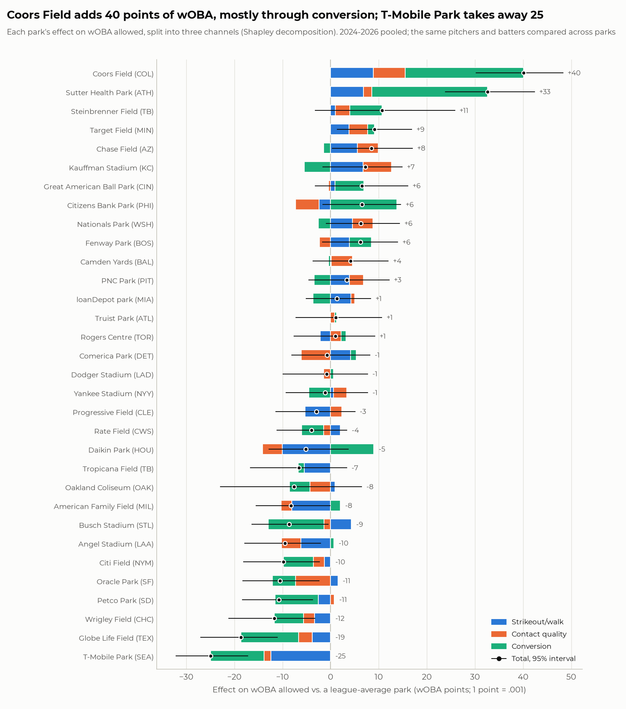
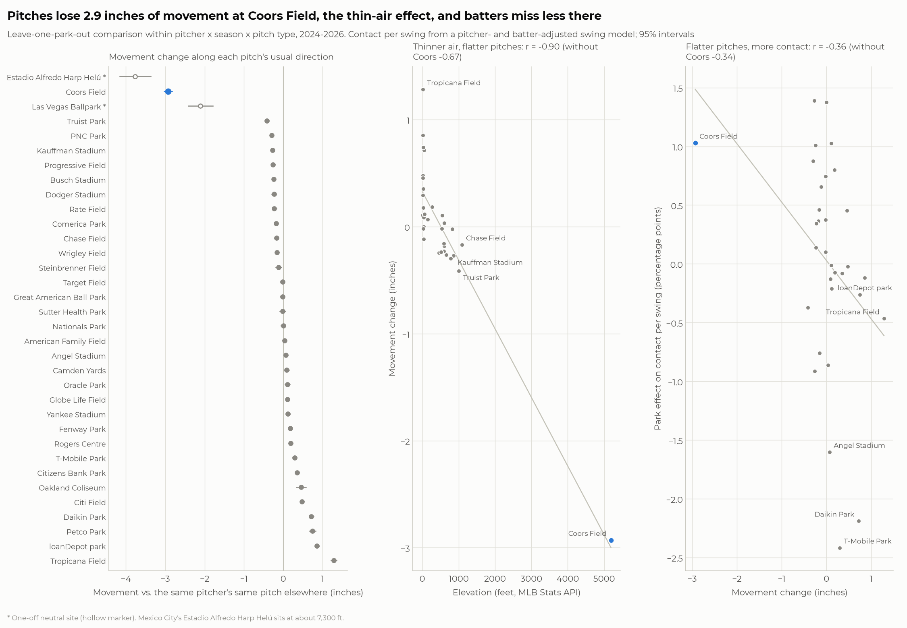
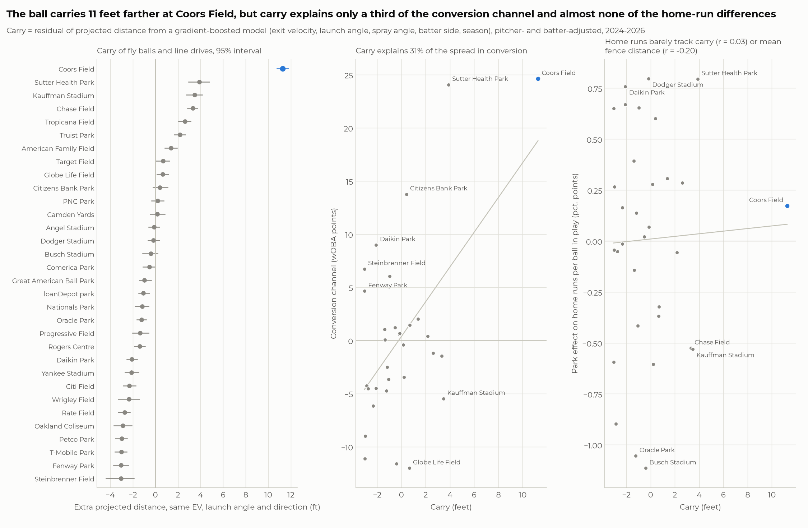
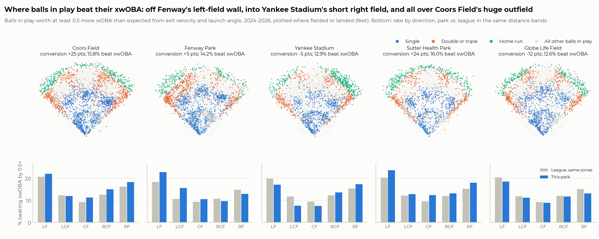
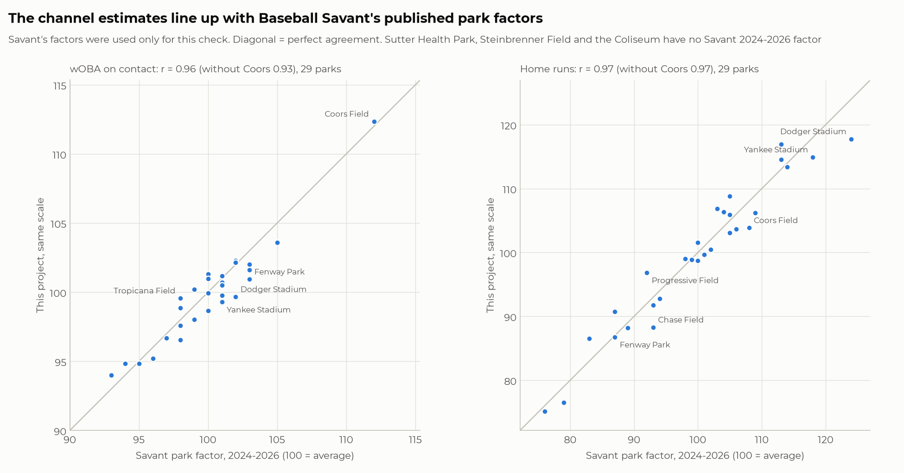
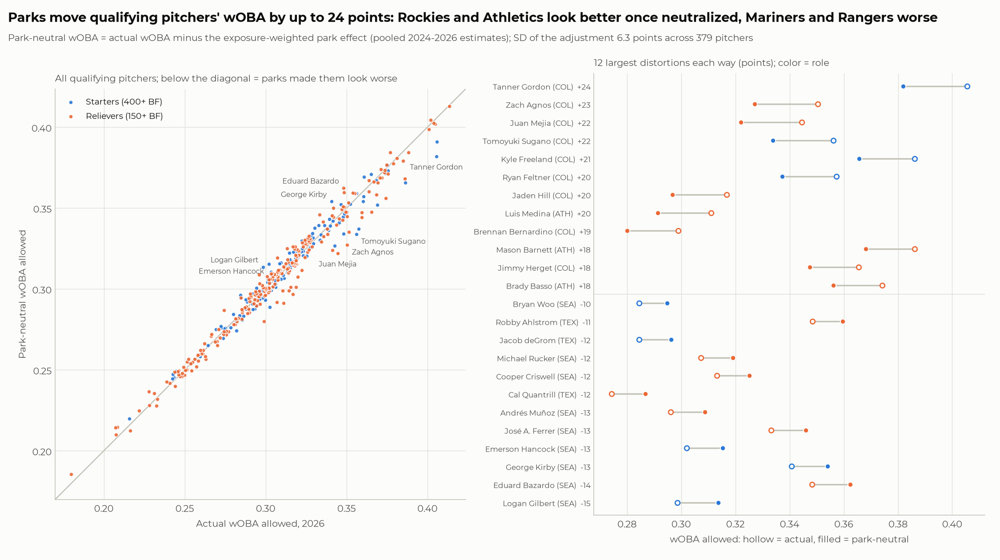
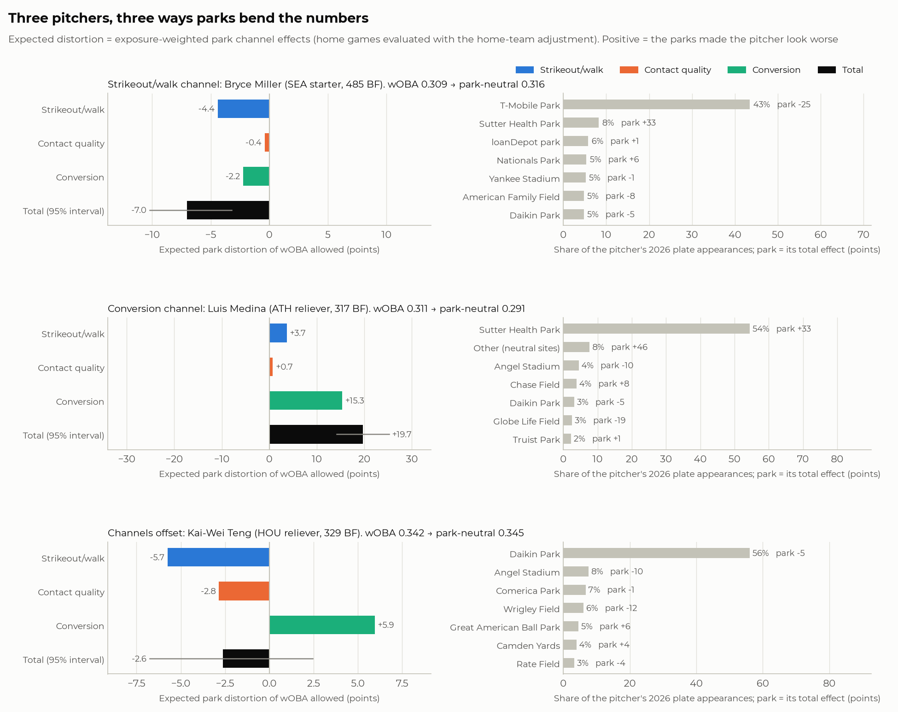
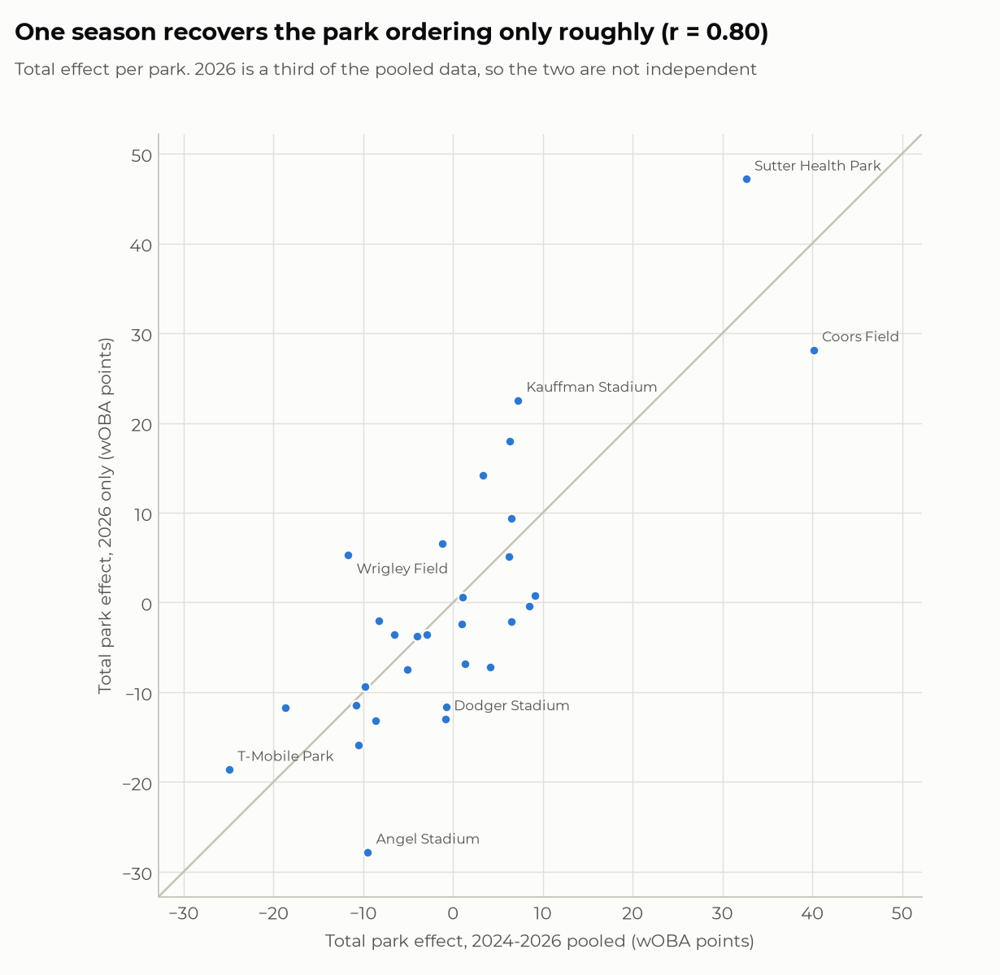

# Why Ballparks Distort Pitching Stats: 2026 MLB Regular Season

A pitcher's numbers depend on where they pitch. This project measures **how** each MLB ballpark
bends pitching results, and **why**. It splits every park's effect on **wOBA allowed** into
three channels:

1. the **strikeout/walk channel**: how often plate appearances end without a ball in play;
2. the **contact-quality channel**: how hard and at what angle the ball is hit (xwOBA on
   contact);
3. the **conversion channel**: how often that contact turns into hits (wOBA minus xwOBA on
   contact).

It then tests the physics behind each channel, checks the estimates against Baseball Savant's
published park factors, and shows what the channels do to individual 2026 pitchers.

## Key findings

- **Coors Field is the most hitter-friendly park by a clear margin: +40 wOBA points**
  [95% interval 30 to 48], against +33 for the Athletics' Sutter Health Park. Coors ranks first
  in 89% of bootstrap resamples. Its effect runs through all three channels:
  - conversion +25;
  - strikeout/walk +9, almost all from lost strikeouts;
  - contact quality +7.

  **T-Mobile Park is the most pitcher-friendly (−25)**, through strikeouts (−12) and conversion
  (−11). Across parks the total effect has an SD of 13 points (1 point = .001 wOBA).
- **Conversion is the biggest channel overall.** It accounts for 56% of the park-to-park
  variance in total effect, against 28% for strikeout/walk and 16% for contact quality.
- **Thin air flattens pitches.** At Coors, a pitcher's same pitch moves **2.9 inches less**
  than it does elsewhere, with spin and velocity unchanged. Batters miss less there, and
  strikeouts fall 2.5 percentage points. Across parks, movement loss tracks elevation
  (r = −0.90; −0.67 without Coors). The four neutral-site games in Mexico City (2024 and 2026),
  at about 7,300 ft, flattened pitches even more (−3.8 in).
- **The ball carries 11 feet farther at Coors** for the same exit velocity, launch angle and
  direction. Carry rises with elevation too (r = 0.79).
  - **Carry explains only a third of the conversion channel.** The rest is geometry:
    - Sutter Health Park's +24 conversion is far more than its 4 extra feet of carry predict;
    - Fenway's left-field wall turns fly balls into doubles;
    - Yankee Stadium's short right field turns them into home runs.
  - **Home-run park effects track neither carry (r = 0.03) nor average fence distance
    (r = −0.20).**
- **The estimates agree with Baseball Savant's park factors**, which were never used as inputs.
  Correlations are r = 0.96 for wOBA on contact, 0.97 for home runs and 0.97 for overall wOBA.
- **Home-field advantage is about 8 wOBA points.** That is about as large as a typical park's
  effect (median 7 points) but a fifth of Coors's, and it is estimated separately from the park
  estimates. There is **no evidence of a "Coors hangover"**: the Rockies' home/road gap is, if
  anything, below average.
- **Parks shift qualifying 2026 pitchers' wOBA by up to 24 points (SD 6.3).**
  - Neutralizing parks helps every qualifying pitcher who spent 2026 with the Rockies or the
    Athletics. Tanner Gordon goes from .406 to .382, and reliever Luis Medina from .311 to
    .291, a jump of 55 places among 242 relievers.
  - It hurts every Mariner and Ranger: Logan Gilbert moves from .299 to .314.
  - The channels matter. Bryce Miller (SEA) is helped mostly through strikeouts, Medina is
    hurt mostly through conversion, and Kai-Wei Teng (HOU) has strikeout and conversion
    effects that cancel out.



---

## How this builds on the first project

**What the first project did.** "WHIP and Simpson's Paradox by Ballpark"
([whip-simpsons-paradox](https://github.com/s-hack432/whip-simpsons-paradox)) worked in four steps:

- It built a custom WHIP park factor: baserunners per out at each venue, divided by the same
  team's road rate.
- It grouped parks into hitter-friendly, neutral and pitcher-friendly tiers.
- It searched for Simpson's-paradox pairs: pitchers better than another pitcher in every tier
  but worse overall.
- It computed a park-standardized WHIP.

It found that:

- Coors (+11%) and Sutter Health (+10%) were the most hitter-friendly parks; T-Mobile (−8.5%)
  and Globe Life (−7%) the most pitcher-friendly.
- Paradox pairs existed (54 among three-tier starters), but none was robust: the best held in
  30% of bootstrap resamples.
- The pairs pointed the right way: in 81% of them the pitcher who looked worse had the tougher
  park mix, against 49% when park labels were shuffled.
- Standardizing moved WHIP by at most about 0.05.

**Its limits.**

- It showed **that** parks distort pitching stats, but treated each park as one number, so it
  could not say **why** Coors and T-Mobile differ.
- WHIP counts a home run the same as a bloop single.
- WHIP mixes the pitcher's own skill with defense and luck on balls in play.

**What this project changes.**

1. **Three channels instead of one number.** The single park factor becomes three
   channel-specific effects on one wOBA scale, estimated in one model family that compares the
   same pitchers and batters across parks.
2. **Mechanism tests.** Each channel is checked against physics and geometry: pitch movement,
   ball carry, and where the extra hits land.
3. **A new question.** The project moves from "which pitchers are misjudged" to "how parks
   distort pitching": each pitcher's distortion is broken down by channel.

The two projects agree where they overlap. Coors and Sutter are still the top two parks, T-Mobile
and Globe Life the bottom two, and the most "underrated" pitchers still come from Colorado and
the Athletics.

## Why these statistics

- **wOBA over WHIP.** wOBA weights each outcome by its run value: in 2026 a home run counts
  2.05, a single 0.89 and a walk 0.70. WHIP treats all hits and walks equally, so wOBA is much
  closer to what determines runs allowed. A park that turns fly-ball outs into doubles and home
  runs (Coors) hurts pitchers far more than its extra singles would suggest.
- **xwOBA as a companion.** xwOBA values each ball in play from its exit velocity and launch
  angle (plus sprint speed on some weakly hit balls). It mostly ignores the park's dimensions.
  So wOBA − xwOBA on contact separates **how well the ball was hit** from **what the park did
  with it**. That gap is what lets contact quality and conversion be estimated as separate
  channels.
- **Strikeout and walk rates.** These capture effects that happen before the ball is put in
  play. Thin air reduces pitch movement, and that shows up here, not in batted-ball stats.
- **Estimating park effects instead of using published factors.** Published factors say **how
  much** a park distorts results, not **why**. Estimating channel-specific effects in one model
  keeps every number on the same footing: the same players, the same seasons, the same wOBA
  scale, adding up exactly to the park's total. Savant's factors then serve as an independent
  check (Step 8) rather than an input.

## The three channels, with Coors Field as the running example

Every plate appearance ends either without a ball in play (strikeout, walk, hit-by-pitch) or
with one. If *c* is the share that ends in a ball in play:

    wOBA  = (1 − c) × (wOBA on non-contact PAs) + c × (wOBA on contact)
    xwOBA = (1 − c) × (wOBA on non-contact PAs) + c × (xwOBA on contact)

| Channel | What the park changes | At Coors Field (wOBA points) |
|---|---|---|
| 1. Strikeout/walk | How often PAs end in a strikeout, walk or HBP, and therefore *c* | **+8.9**: pitches move ~3 inches less, so batters whiff less. The strikeout rate falls 2.5 points, and those PAs become balls in play worth ~.36 wOBA each. Walks barely change. |
| 2. Contact quality | How hard and at what angle balls are hit (xwOBA on contact) | **+6.6**: contact is slightly better (+.009 xwOBAcon), consistent with flatter, more hittable pitches. |
| 3. Conversion | Given the same contact, how often it becomes a hit (wOBAcon − xwOBAcon) | **+24.6**: the ball carries 11 ft farther, and the huge outfield leaves room for hits to drop in, especially in shallow right and center (fig. 4). |
| Total | | **+40.1** [30.2, 48.3] |

The channel values come from a Shapley decomposition that averages over the order in which
channels are switched on. They add up exactly to the total. The interaction term they share is
1.3 points at Coors and under 1 point everywhere else.

## Data

| Source | What | Notes |
|---|---|---|
| Baseball Savant via `pybaseball.statcast()` | Pitch-level Statcast data, 2024–2026 regular seasons | Weekly parquet chunks in `data/raw/`, `pybaseball.cache.enable()` on. The chunks were reused from the first project's cache (pulled with the same code on 2026-10-02), so `src.fetch` found every chunk on disk. Spot-checked against a fresh Savant pull: per-ball xwOBA values are unchanged. |
| MLB Stats API | Season dates, schedules with venue per game, team abbreviations, player names, venue elevation and fence distances | Cached JSON in `data/raw/mlb_api/` |
| Baseball Savant leaderboards | Expected-statistics leaderboards (2024–2026) and Statcast park factors (2024–2026 rolling and 2026 one-year) | **Validation only** (Steps 3 and 8). Cached in `data/external/`. |
| Chadwick register via `pybaseball.playerid_reverse_lookup` | Player names | Stats API spelling preferred where both exist |

**Season windows.** The Stats API gives the 2026 regular season as **March 25 to September 27,
2026**, matching the spec, and the first and last `game_date` match. Only `game_type == "R"`
is used; this drops 20,583 spring-training rows from the 2024 pulls, 29,552 from 2025 and none
from 2026. Every completed game is present:

| Season | Regular-season pitches | Games | Plate appearances (in wOBA) |
|---|---|---|---|
| 2024 | 711,899 | 2,429 (1 cancelled) | 182,449 (181,388) |
| 2025 | 712,528 | 2,430 | 182,926 (181,724) |
| 2026 | 716,792 | 2,429 (BAL @ NYY, Sept 27, cancelled) | 183,849 (182,539) |

Park profiles use 2024–2026 pooled; a 2026-only fit is the robustness check. Pitcher-level
analysis uses 2026 only.

## Methods

### 1. Venues (`src/venues.py`)
Every `game_pk` gets its venue from the MLB schedule, never from `home_team`. The venue ID is
the unit: renamed parks keep one identity (Daikin Park, Rate Field, UNIQLO Field at Dodger
Stadium), and relocated teams get a new venue for each park.

- **Athletics:** Oakland Coliseum in 2024, Sutter Health Park in 2025–26.
- **Rays:** Tropicana Field in 2024 and 2026, George M. Steinbrenner Field in 2025.

A venue gets its own park effect if it was some team's home park in the fit window: 32 venues
pooled, 30 in 2026. Every game played there counts toward it, including the Red Sox's
September 27 "home" game at Tropicana Field. All other venues are pooled into one **"other"**
category. These stay in pitcher totals but are not interpreted as parks:

- 2024: Seoul, Mexico City, London, Rickwood Field, Williamsport;
- 2025: Tokyo, Bristol, Williamsport;
- 2026: Mexico City, Field of Dreams, Williamsport, and six Athletics games at Las Vegas
  Ballpark.

"Other" holds 22 games and 1,788 of 549,224 PAs (0.33%) pooled, and 10 games and 830 PAs
(0.45%) in 2026.

### 2. Plate-appearance table (`src/prepare.py`, `src/woba.py`)
One row per plate appearance: the pitch with a non-null `events`. Truncated PAs (an inning ended
on a baserunning out mid-PA) are not PAs and are dropped: 316, 319 and 329 per season.

- **Outcome types.**
  - strikeout (including strikeout double plays);
  - walk (including intentional);
  - HBP;
  - ball in play (every batted ball, including sacrifice bunts);
  - other (catcher's interference).
- **wOBA follows Savant's leaderboard convention. This is a deviation from the spec that the
  project owner approved.** The spec asked for the raw `woba_value`/`woba_denom` columns, but
  those reproduce Savant's own pitcher leaderboard for only 14% of 100+ PA pitchers, for three
  reasons:
  - `woba_value` uses rounded weights (1B 0.9, HR 2.0) while the leaderboard and the xwOBA
    column use season weights;
  - `woba_value` scores reached-on-error and fielder's choice as 0.9 (a single) where the
    leaderboard scores them 0;
  - Savant blanks `woba_denom` on PAs whose pitch was not tracked (~0.35%).

  The convention used here:
  - season linear weights;
  - errors, fielder's choices and strikeouts where the batter reached = 0;
  - denominator = PA − IBB − sacrifice bunts − catcher's interference;
  - untracked PAs kept.

  The BB and HBP weights are the constants Savant writes into the xwOBA column for walks and
  HBP. The 1B/2B/3B/HR weights are fitted by least squares to Savant's **batter** leaderboard
  (residual SD 0.0003, i.e. rounding), so the **pitcher** leaderboard stays an independent
  check. The 2024 weights reproduce FanGraphs' published 2024 values (BB .689, HBP .720,
  1B .882, 2B 1.254, HR 2.050). See `outputs/tables/woba_weights.csv`.
- **Balls in play missing exit velocity or launch angle.** 370, 438 and 506 per season (≈0.3–0.4%).
  - **Where they cluster:** strongly by park (χ² p ≈ 0). In 2026, **4.6% of balls in play at
    Great American Ball Park** are missing, against <0.6% elsewhere among home parks.
  - **What they are:** 92% are ground balls and 80% are outs.

  Dropping them would remove mostly weak grounders and inflate the affected park's contact and
  wOBA. So they are **kept, with an imputed xwOBA**:
  - 46 balls with EV and LA but no Savant estimate get an emulator of Savant's xwOBA from EV,
    LA and season (gradient boosting, holdout R² 0.995);
  - 1,314 with no EV/LA get the mean xwOBA of tracked balls with the same season, batted-ball
    type and result.

  Every ball carries an `xwoba_source` flag (`outputs/tables/missing_tracking_by_park.csv`).
- **Spray angle** = atan2(hc_x − 125.42, 198.27 − hc_y) in degrees: 0 = center field,
  negative = left field. A pull-side version flips the sign for right-handed batters. Feet from
  home = 2.49 × pixel offset; the scale is calibrated as projected distance ÷ pixel radius on
  68,181 fly-ball outs caught by outfielders.
- **Validation (`tests/test_validation.py`).** Computed 2026 values against Savant's pitcher
  leaderboard, for 517 pitchers with 100+ PA:

  | Check | Same after rounding (≤0.0005) | Within 0.001 | Within 0.002 | Largest gap |
  |---|---|---|---|---|
  | PA and BIP counts | 100% identical | | | 0 |
  | wOBA | **99.0%** | 99.4% | 99.6% | 0.0057 |
  | xwOBA, Savant-style (untracked balls left out) | 90.7% | 93.8% | **98.8%** | 0.0026 |
  | xwOBA, this project (untracked balls imputed) | 70.2% | 85.1% | 95.2% | 0.0064 |

  - **wOBA:** the three largest gaps (Shawn Armstrong, Paul Blackburn, Jake Irvin) each trace to
    one play that official scoring changed after the data were pulled. Comparing with a fresh
    Savant pull, each is a reached-on-error re-scored as a single or vice versa.
  - **xwOBA, Savant-style:** per-ball xwOBA values are identical in a fresh pull (checked for the
    two largest gaps), so the residual differences come from Savant's leaderboard aggregation.
    The largest are at most 0.0026.
  - **xwOBA, imputed version:** the biggest gaps belong to pitchers with many imputed balls,
    such as Sam Moll (12). That gap is the intended effect of not dropping them.

  2024 and 2025 match as well or better.

### 3. Park effects by channel (`src/park_model.py`, `src/ridge.py`)
Five models (plus two used for checks and Step 8), each at the plate-appearance level:

    outcome ~ park + season + same-hand platoon + pitcher's-team-at-home + pitcher + batter

| # | Outcome | Sample |
|---|---|---|
| 1 | Strikeout | All 545,651 PAs in the wOBA denominator, 2024–26 |
| 2 | Walk + HBP | same |
| 3 | Ball in play (*c*) | same |
| 4 | xwOBA on contact | 372,008 balls in play |
| 5 | Conversion: wOBA value − xwOBA | same |
| (6) | Home run per ball in play (Step 8) | same |
| (7) | wOBA and wOBAcon directly (consistency checks) | PAs / balls in play |

**Design and penalties.**

- Sparse one-hot design: 32 parks + "other", 1,310 pitchers, 904 batters, season, platoon and
  home terms.
- There is no global intercept; one park dummy per venue acts as the intercept, so parks are
  **unpenalized**.
- **Ridge penalties apply to pitcher and batter effects only**, chosen by 5-fold
  cross-validation over whole games on a 9×9 grid of (λ_pitcher, λ_batter).
- Models 1–3 share one pair (100, 30), the pair minimizing their summed held-out error. Each
  outcome's own optimum is within 0.00004 MSE of it. Sharing makes the strikeout, walk/HBP and
  contact shares sum to exactly 1 in every park.
- Contact quality (1000, 100) and conversion (3000, 1000) get their own pairs. The heavy
  penalties reflect how little of conversion is player skill.
- Solved through the normal equations with a dense Cholesky factorization: ~2,250 columns.
- Park effects are centered at zero, weighted by PAs (balls in play for models 4–6).

**Uncertainty.** 500 bootstrap resamples of games, drawn with replacement within each season ×
venue, refitting every model with the cross-validated penalties.

**Robustness.**

| Check | Result |
|---|---|
| Penalties ÷4 or ×4 | Park effects correlate r ≥ 0.96 with the main fit (max change 0.005) |
| Raw Statcast columns instead of the approved convention | r ≥ 0.995; Coors total 41.3 vs 40.1 |
| Logistic instead of linear-probability models (strikeout, walk/HBP, BIP, HR) | r = 0.997–0.9998 on the probability scale |
| 2026 only instead of 2024–26 | See Results |

### 4. From channels to wOBA points (`src/decompose.py`)
Within the wOBA denominator, wOBA = W × w_W + c × (x + v):

- W = walk + HBP rate and w_W its mean weight (0.697);
- c = contact share;
- x = xwOBAcon and v = conversion.

The neutral park uses the 2024–26 league means: K .225, W .094, c .682, x .367, v −.003. These
reproduce league wOBA (.3132) exactly. Each park shifts every quantity by its centered effect.

Switching one channel at a time from neutral gives order-dependent answers, because *c*
multiplies (x + v). So each channel gets its **Shapley value**, its average marginal effect over
all six orderings. The reported interaction is what one-at-a-time attributions would leave
over, Δc(Δx + Δv). It is at most 1.3 points. Channel 1 is split exactly into a strikeout part
and a walk/HBP part.

Two checks on the decomposition:

- The decomposition total correlates 0.99 with a model fit directly to wOBA.
- Bootstrap draws give intervals for every channel.

### 5. Mechanism checks (`src/mechanisms.py`)
Every check compares the same players across parks.

1. **Pitch movement.** For each pitcher × season × pitch type, movement, velocity and spin at a
   venue are compared with the same pitch everywhere else that season (leave-one-park-out;
   ≥50 pitches elsewhere). The differences are averaged per venue, weighted by pitches there.
   - Main metric: change in movement along the pitch's usual direction (negative = flatter).
   - The comparison then ties movement to park effects on strikeouts, balls in play, and a
     contact-per-swing model built like Step 4: 1.02 million swings, contact = foul or in play.
   - Elevation and fence distances come from the MLB Stats API (current values).
2. **Ball carry.** Gradient boosting predicts `hit_distance_sc` for 187,745 fly balls and line
   drives from exit velocity, launch angle, spray angle, batter side and season.
   - Fit quality: 5-fold cross-fitting by game, out-of-fold R² 0.952 and RMSE 16.3 ft
     (exit velocity and launch angle alone: 0.929).
   - A park's carry is its mean residual, adjusted for batter and pitcher with the Step 4
     design, with a 200-resample game bootstrap.
3. **Where extra hits land.** Balls in play that beat their xwOBA by 0.5+ (13.6% league-wide)
   are mapped for Coors, Fenway, Yankee Stadium, Sutter Health Park (largest positive
   conversion after Coors) and Globe Life Field (most negative). Their rate by field direction
   and depth is compared with the league rate in the same zones.
4. **Home field.** The Step 4 home coefficients are converted into wOBA points.
   - **"Coors hangover" test:** the pooled wOBA model is refit with team-specific home terms,
     separately for pitchers and for batters (200 bootstrap resamples each).
   - The Rockies' term is compared with the other 29 teams'.

### 6. Pitcher-level analysis (`src/pitchers.py`)
**Qualifiers.** A pitcher is a starter if at least half of their appearances were starts. The
spec's thresholds were kept unchanged: **137 starters with 400+ batters faced and 242 relievers
with 150+**.

**Per-pitcher quantities.**

- **Park exposure:** share of the pitcher's wOBA plate appearances in each park.
- **Expected distortion** for each channel: Σ_parks exposure × that park's Shapley channel
  value, using the pooled 2024–26 park effects. The 95% interval comes from the 500 bootstrap
  draws.
- **Home-team adjustment.** The spec asks that "home games use the home-team adjustment." Here
  that means each home plate appearance's park effect is evaluated from the baseline of a
  pitcher working at home, and each road PA's from the baseline of a visiting pitcher. Both
  baselines are the league means shifted by the Step 4 home coefficient.

  Home-field advantage itself is **not** counted as park distortion. Every pitcher works about
  half their PAs at home, so it would barely move anyone (SD 0.4 points across qualifiers); it
  is reported separately as `home_field_pts`.
- **Park-neutral wOBA** = actual − total distortion.
- **Rank change** within role.

**Case studies (selection rule).** Each pitcher pitched for one team all season. The channel
named in the case carries at least 60% of the pitcher's total channel magnitude, and the
interval for the total excludes zero; the largest such effect wins. The offsetting case has the
most channel magnitude cancelling out. Each case comes from a different team.

### 7. Savant validation (`src/validate_savant.py`)
Savant's 2024–2026 Statcast park factors (index, 100 = average) are compared with ours,
converted to the same scale as the predicted rate at the park ÷ the league rate × 100:

- Savant's wOBAcon factor against our contact-quality + conversion channels combined;
- Savant's HR factor against our home runs per ball in play;
- also xwOBAcon, strikeouts, walks and overall wOBA;
- the 2026-only fit against Savant's one-year 2026 factors.

## Results

### Park channel profiles
Figure 1 (top of page) shows all 32 parks. Highlights, in wOBA points (2024–26 pooled; full
table with intervals in `outputs/tables/park_wOBA_decomposition.csv`):

| Park | Total [95% interval] | Strikeout/walk | Contact | Conversion |
|---|---|---|---|---|
| Coors Field (COL) | **+40.1** [30.2, 48.3] | +8.9 | +6.6 | +24.6 |
| Sutter Health Park (ATH) | **+32.6** [23.9, 42.4] | +6.8 | +1.7 | +24.1 |
| Steinbrenner Field (TB, 2025) | +10.7 [−3.2, 25.8] | +1.0 | +2.9 | +6.7 |
| Target Field (MIN) | +9.2 [1.4, 16.9] | +3.8 | +3.9 | +1.4 |
| Chase Field (AZ) | +8.5 [0.3, 17.0] | +5.5 | +4.4 | −1.5 |
| Kauffman Stadium (KC) | +7.2 [−1.6, 14.9] | +6.7 | +6.0 | −5.5 |
| Citizens Bank Park (PHI) | +6.5 [−1.6, 14.6] | −2.4 | −4.9 | +13.8 |
| Fenway Park (BOS) | +6.2 [−1.6, 13.9] | +3.9 | −2.3 | +4.6 |
| Yankee Stadium (NYY) | −1.2 [−9.3, 7.7] | +0.6 | +2.8 | −4.5 |
| Daikin Park (HOU) | −5.1 [−12.8, 3.7] | −10.1 | −4.1 | +9.0 |
| Busch Stadium (STL) | −8.6 [−16.4, −0.5] | +4.3 | −1.4 | −11.6 |
| Oracle Park (SF) | −10.5 [−18.2, −2.4] | +1.5 | −7.3 | −4.7 |
| Globe Life Field (TEX) | **−18.7** [−27.0, −11.1] | −3.8 | −2.8 | −12.0 |
| T-Mobile Park (SEA) | **−24.9** [−32.2, −17.2] | −12.4 | −1.4 | −11.1 |

**The channels have different signatures.**

- **Conversion parks:** Coors, Sutter Health and Citizens Bank Park.
- **Strikeout parks:** T-Mobile, Daikin and American Family Field (the strikeout/walk channel
  at −8 to −12).
- **Contact parks:** Oracle Park suppresses contact quality (−7).
- **Opposite-signed channels:**
  - Daikin Park: strikeouts −10, but its short left-field porch (the Crawford Boxes) adds +9 in
    conversion.
  - Kauffman Stadium: +13 from fewer strikeouts and better contact, offset by −5.5 in
    conversion from its huge outfield.

**Which channels are well determined.** 95% intervals exclude zero for 18 of 32 parks' strikeout/walk
effects, 11 conversion effects, 13 totals and only 4 contact-quality effects. The neutral sites
together ("other", 1,779 PAs) come out at +46 [19, 70], dominated by Mexico City and Las Vegas.

**Spec sanity checks.**

1. **Coors has the largest total effect: pass.** +40.1 against +32.6 for the next park; Coors
   is #1 in 89% of bootstrap resamples. Sutter Health Park is a genuine second. It is the
   minor-league park in Sacramento the Athletics moved into for 2025, and in 2026 alone it
   rates above Coors (+47 vs +28), as it did in the first project.
2. **Fenway's effect comes mostly from conversion: pass, narrowly.** Conversion is Fenway's
   largest channel (+4.6) and 74% of its net effect, but strikeout/walk is close behind (+3.9)
   and the total (+6.2) has an interval that includes zero. This was investigated before
   continuing:
   - **Raw conversion at Fenway:** visiting hitters convert at the league rate (−0.001), Red
     Sox hitters well above it (+0.018).
   - **Red Sox hitters on the road:** they also convert well (+0.007). The model, which
     compares the same batters across parks, correctly credits part of the home edge to the
     hitters rather than the park.
   - **By direction:** balls to Fenway's left side convert much better than league (+0.090 vs
     +0.041 per ball; the Green Monster). Balls to its deep right field convert worse (−0.021 vs
     +0.013). The modest net is real geometry pulling both ways.

### Why the channels move: mechanisms



**Movement (strikeout/walk and contact channels).**

- **Coors:** the same pitcher's same pitch moves **2.93 ± 0.10 inches less** than elsewhere.
  Four-seam ride drops 3.0 inches. Spin (+16 rpm) and velocity (−0.1 mph) are unchanged, so
  this is air, not pitcher behavior.
- **Neutral sites:** Mexico City (≈7,300 ft) shows −3.8 inches; Las Vegas Ballpark shows −2.1.
- **Elevation:** movement loss tracks elevation across the 32 parks, at −0.64 inches per 1,000
  ft (r = −0.90; −0.67 without Coors). That predicts −3.0 inches at Coors (observed −2.9).
  Sea-level domes and marine-air parks show slightly **more** movement (Tropicana +1.3,
  loanDepot +0.9, Petco +0.7).
- **Links to the channels:** parks that flatten pitches have more contact per swing (Coors
  +1.0 points; r = −0.36), fewer strikeouts (r = 0.48 between movement change and the
  strikeout effect) and more balls in play (r = −0.49). Contact per swing and the strikeout
  effect are tightly linked (r = −0.91).

Apart from altitude, strikeout parks are not movement parks. T-Mobile Park and Daikin Park
have the lowest contact rates (−2.4 and −2.2 points) with ordinary movement, which points to
something else, such as hitting background or lighting. This project can't separate those.



**Carry (conversion channel).** The ball carries **11.3 ft** [10.8, 11.8] farther at Coors than
the same exit velocity, launch angle and direction would predict.

- **Next-highest carry:** Sutter Health (+3.9), Kauffman (+3.5) and Chase (+3.3).
- **Shortest carry:** Fenway, Steinbrenner, T-Mobile and Petco, at about −3 ft each.
- **Elevation:** carry rises 2.5 ft per 1,000 ft of elevation (r = 0.79).

But carry explains only **31%** of the park-to-park spread in conversion, and the parks it misses
are about geometry:

- **More conversion than carry predicts:** Sutter Health (+17 points), Citizens Bank Park
  (+13), Daikin (+12, the Crawford Boxes), Steinbrenner (+11, built to Yankee Stadium's
  dimensions) and Fenway (+9).
- **Less than carry predicts:** Globe Life (−13), Kauffman (−12: carry, but deep fences) and
  Busch (−11).

**Home runs (Step 8's HR model) are almost unrelated to carry** (r = 0.03), and only weakly to the
average fence distance (r = −0.20, not significant). Three of the top four home-run parks
(Dodger Stadium, Daikin, Yankee Stadium) have average or below-average carry. Kauffman and
Chase carry well but rank near the bottom in home runs. Home-run rates depend on finer
geometry, such as wall heights, porch shapes and fence angles, that five reported fence
distances don't capture.



**Where extra hits land.**

- **Fenway:** balls 250–330 ft to left and left-center beat their xwOBA 1.6–2.2× as often as
  league balls in the same zones. These are doubles and singles off the Monster.
- **Yankee Stadium:** the excess sits at 330+ ft to right and right-center (1.3×), the short
  porch.
- **Coors:** the extra hits spread across the outfield, especially shallow right and center
  (1.4–1.5×), where the huge outfield leaves room for hits to drop in.
- **Sutter Health:** deep center (2.2×).
- **Globe Life:** below the league rate in most zones.

**Home field.** A pitcher at home allows **7.8 fewer wOBA points** than a visiting pitcher in the
same park (direct model −8.0 [−10.9, −5.1]). That splits into strikeout/walk −4.8, contact
−1.3 and conversion −1.7. It is real, but smaller than the SD of park effects (12.7 points) and
far smaller than the 65-point range from Coors to T-Mobile. It is estimated separately from the
park effects, not inside them.

**No Coors hangover.** With team-specific home terms, the Rockies' home edge is **smaller** than
the average team's. That holds for pitchers (difference +0.007 wOBA [−0.013, +0.026]; 24th of
30 in home edge) and for hitters (−0.007 [−0.027, +0.008]; 24th of 30). The intervals include
zero, so the data show no sign that Rockies players do unusually badly on the road once Coors
is accounted for.

### Validation against Savant



| Comparison (29 parks, 2024–26) | Pearson r | Without Coors | Spearman |
|---|---|---|---|
| wOBA on contact (contact + conversion) | **0.96** | 0.93 | 0.89 |
| Home runs (ours per ball in play) | **0.97** | 0.97 | 0.96 |
| xwOBA on contact | 0.77 | 0.78 | 0.78 |
| Strikeouts | 0.93 | 0.92 | 0.89 |
| Walks (ours include HBP) | 0.74 | 0.73 | 0.68 |
| wOBA (all channels) | 0.97 | 0.95 | 0.93 |

Against Savant's one-year 2026 factors (30 parks), the 2026-only fit correlates 0.97 (wOBA on
contact), 0.97 (home runs) and 0.98 (wOBA). The two scales also match in spread: the SD of the
wOBA-on-contact index is 3.5 here and 3.7 for Savant.

**Biggest disagreements.** They are small: at most 2.3 index points on wOBA on contact and 6
on home runs.

- **Lower than Savant:** Dodger Stadium (HR 118 vs 124; wOBAcon 99.7 vs 102), Fenway (100.9 vs
  103) and Yankee Stadium (99.3 vs 101). These are parks with strong home lineups, and the
  pattern fits our model attributing part of the home team's results to its hitters. The
  Fenway investigation above found exactly that.
- **Window and scale:** the windows match, including Tropicana (2024 and 2026 in both). Savant's
  HR index may be per PA rather than per ball in play. Parks used for only part of the window (Sutter
  Health, Steinbrenner, the Coliseum) have no Savant three-year factor.

### Pitchers: how much parks distort 2026 numbers



**Size of the distortion.**

- Across the 379 qualifiers, expected park distortion has an SD of **6.3 wOBA points** and
  ranges from **−15 to +24**.
- 148 pitchers have a 95% interval that excludes zero, and 41 have a distortion of 10+ points.
- Rankings move by an average of 5.4 places among starters (20 of 137 move 10+) and 8.2 among
  relievers (71 of 242 move 10+).

**Who it affects.** By team, distortion mirrors the home park. Every qualifier who spent the
season with the Rockies (10) or Athletics (12) is underrated, by +12 to +24 points. Every
Mariner (11) and Ranger (11) is overrated, by −7 to −15. The largest channel is
conversion for 184 qualifiers, strikeout/walk for 139 and contact quality for 56. xwOBA isn't
park-neutral either: it absorbs the strikeout/walk and contact channels (SD 3.6 points;
`park_neutral_xwoba` in the CSV).

**Most hurt by their parks** (underrated):

| Pitcher | Role | wOBA → park-neutral | Distortion [95%] | Main channel | Rank among role |
|---|---|---|---|---|---|
| Tanner Gordon (COL) | SP | .406 → .382 | +23.6 [17.9, 28.5] | conversion +14.9 | 136 → 136 |
| Tomoyuki Sugano (COL) | SP | .356 → .334 | +22.4 [17.4, 26.6] | conversion +14.1 | 124 → 104 |
| Zach Agnos (COL) | RP | .350 → .327 | +23.3 [18.4, 27.9] | conversion +14.3 | 210 → 176 |
| Jaden Hill (COL) | RP | .317 → .297 | +20.0 [15.3, 24.2] | conversion +12.8 | 148 → 90 |
| Luis Medina (ATH) | RP | .311 → .291 | +19.7 [14.2, 25.2] | conversion +15.3 | 131 → 76 |
| J.T. Ginn (ATH) | SP | .303 → .289 | +13.9 [9.8, 18.5] | conversion +12.6 | 55 → 27 |

**Most helped by their parks** (overrated):

| Pitcher | Role | wOBA → park-neutral | Distortion [95%] | Main channel | Rank among role |
|---|---|---|---|---|---|
| Logan Gilbert (SEA) | SP | .299 → .314 | −15.1 [−19.2, −10.6] | strikeout/walk −7.8 | 44 → 71 |
| Emerson Hancock (SEA) | SP | .302 → .315 | −13.3 [−17.1, −9.3] | strikeout/walk −7.0 | 51 → 73 |
| Jacob deGrom (TEX) | SP | .285 → .296 | −11.8 [−16.1, −8.1] | conversion −6.8 | 21 → 41 |
| Eduard Bazardo (SEA) | RP | .348 → .362 | −14.1 [−18.0, −9.8] | strikeout/walk −7.3 | 204 → 221 |
| Andrés Muñoz (SEA) | RP | .296 → .309 | −12.6 [−16.6, −8.4] | strikeout/walk −7.0 | 87 → 124 |
| Cal Quantrill (TEX) | RP | .274 → .287 | −12.4 [−16.7, −8.9] | conversion −6.8 | 52 → 67 |

**Case studies: three pitchers, three channels.**



- **Strikeout/walk: Bryce Miller (SEA starter).** Park distortion −7.0 [−10.2, −3.2], of which
  −4.4 comes from the strikeout/walk channel, nearly all extra strikeouts. Contact (−0.4) and
  conversion (−2.2) add little. 43% of Miller's PAs came at T-Mobile Park, where pitchers get
  12 points of wOBA help from strikeouts alone. A .309 wOBA becomes .316 park-neutral, from
  63rd to 74th among starters.
- **Conversion: Luis Medina (ATH reliever).** Distortion +19.7 [14.2, 25.2]: conversion +15.3,
  strikeout/walk +3.7, contact +0.7. 54% of Medina's PAs came at Sutter Health Park (+24
  conversion) and 8% at the Athletics' Las Vegas games. Medina's xwOBA (.305) was ordinary, but
  more of the contact fell for hits. Neutralized, .311 becomes .291, and Medina jumps
  from 131st to 76th of 242 relievers.
- **Channels offset: Kai-Wei Teng (HOU reliever).** Daikin Park gives pitchers strikeouts
  (−5.7 from the strikeout/walk channel, −2.8 contact) but takes it back through the Crawford
  Boxes (+5.9 conversion). The net is −2.6 [−6.8, +2.4]: a single park number would call
  Daikin nearly neutral for Teng, even though its channels pull hard in opposite directions.

**Simpson's paradox, briefly.** The 2026 parks were split into three PA-weighted groups by
total effect (`park_groups_2026.csv`). Within role, 118 pairs (75 starters, 43 relievers) have
one pitcher with the lower wOBA in all three groups but the higher wOBA overall. In 75% of them
that pitcher had the more hitter-friendly park mix: the first project's pattern again. No
single pair was bootstrapped here; the first project found such pairs individually fragile.

### Robustness: one season vs three



The 2026-only fit has much wider intervals: the average half-width of the total is 14.7 points,
against 8.6 pooled. It correlates **0.80** with the pooled totals (mean absolute difference 7.3
points). By channel: strikeout/walk 0.81, contact 0.71, conversion 0.80.

Notable one-season swings:

- Sutter Health +47 in 2026 alone (pooled +33);
- Coors +28 (pooled +40);
- Kauffman +23 (pooled +7);
- Angel Stadium −28 (pooled −10).

2026 is a third of the pooled data, so this understates how much independent seasons
disagree. Single-season park estimates are noisy, especially in the conversion channel; the
pitcher analysis therefore uses the pooled estimates.

## Limitations

- **xwOBA is not perfectly park-neutral.**
  - It uses sprint speed on some batted balls.
  - Tracking calibration can differ between parks. The 2026 tracking gaps at Great American
    Ball Park are one sign, and the ±1-inch movement differences among sea-level parks may
    include some measurement differences.
  - Anything that makes xwOBA itself park-dependent is shared out between the contact and
    conversion channels.
- **Park effects estimated from three seasons are noisy, especially the conversion channel.**
  Most parks' total-effect intervals are ±8 points, and only 11 of 32 conversion effects
  exclude zero. One season alone is much noisier (r = 0.80 with the pooled estimates).
- **No weather data.** Temperature and wind change carry from game to game; here they are
  averaged into each park's effect. Roofs, domes and the time of year a park's games fall in
  are part of its "park effect."
- **Regularization choices shape the estimates.**
  - Shrinking player effects lets a little of the home team's talent leak into its park, and
    one effect per player across 2024–26 ignores within-window talent changes.
  - Changing the penalties four-fold either way moves park effects by at most 0.005
    (r ≥ 0.96), but the choice is still a modeling assumption.
- **Team defense travels with the home park.** The model has pitcher and batter effects but no
  fielder effects. Part of a park's conversion effect may be its home team's defense; the home
  coefficient only partly separates it.
- **Physical attributes are current values.** The Stats API's elevation and fence distances
  describe parks as of 2026. Wall heights are not available, and some parks have changed
  dimensions in recent years.
- **The "other" category mixes very different neutral sites.** For pitcher totals it is treated
  as one park; it covers 0.3% of PAs.
- **The pitcher analysis applies league-average park effects.** It assumes a park affects every
  pitcher the same way, regardless of pitcher type. Fly-ball pitchers, for example, probably
  feel Coors more than ground-ball pitchers do.

## Extensions

- **Weather.** Add game-time temperature, wind and humidity (or air density) to separate climate
  from structure, especially for carry.
- **Park effects by batter handedness.** Yankee Stadium's short porch matters for left-handed
  hitters, Fenway's wall for right-handed ones. The spray data already show the asymmetry.
- **Times through the order.** Cross park effects with `n_thruorder_pitcher` (already in the
  PA table): does Coors's movement penalty compound as hitters see a pitcher again?
- **Pitcher-specific park effects.** Let the channels vary with a pitcher's batted-ball profile
  (fly-ball vs. ground-ball, spin-dependent arsenals).
- **Fielder effects.** Add fielder effects to separate park conversion from home-team defense.

## Judgment calls and deviations from the spec

1. **wOBA follows Savant's leaderboard convention, approved by the project owner.** This
   replaces the raw `woba_value`/`woba_denom` columns, which match the leaderboard for only 14%
   of pitchers. The raw-columns version is kept as a sensitivity check (r ≥ 0.995 for park
   effects).
2. **Untracked PAs are kept, with imputed xwOBA for untracked balls in play.** The raw
   `woba_denom` is blank on them. Dropping them would bias Great American Ball Park in 2026.
3. **Two penalties per model (pitcher and batter), cross-validated jointly.** The spec's single
   ridge penalty became a pair. Models 1–3 share one pair so the outcome shares stay exhaustive;
   each is within 0.00004 MSE of its own optimum.
4. **The pooled fit has one effect per player across 2024–26.**
5. **"Home games use the home-team adjustment"** is read as evaluating home PAs from the
   home-pitcher baseline. Home-field advantage itself is not counted as park distortion; it is
   reported separately.
6. **Neutral-site games at a regular park count toward that park.** The Red Sox game at Tropicana
   is Tropicana. Other one-off venues form the "other" category.
7. **Additions beyond the spec:**
   - the contact-per-swing model;
   - elevation and fence-distance tests from the MLB Stats API;
   - logistic checks;
   - park-neutral xwOBA;
   - the explicit case-study selection rule.
8. **Data reuse.** Statcast chunks were reused from the first project's cache (same code, pulled
   2026-10-02) instead of being downloaded again.
9. **Project root.** The spec's tree calls the project root `park-distortion/`; this repository
   is `why-ballparks-distort-pitching-stats`.
10. **The final Step 6 run reused the saved Coors-hangover results.** That run was made with
    `--skip-hangover` after an earlier run was stopped for low system memory; the hangover
    inputs had not changed. The full computation runs without the flag.

## Reproducing

```bash
python -m venv .venv
.venv\Scripts\activate            # Windows; on macOS/Linux: source .venv/bin/activate
pip install -r requirements.txt

python -m src.fetch               # Step 1: Statcast 2026, then 2024-25 (skips chunks on disk)
python -m src.venues              # Step 2: venue per game, neutral sites, venue attributes
python -m src.prepare             # Step 3: PA table, wOBA weights, missing tracking, Savant validation
python -m src.park_model          # Step 4: channel models, CV, 500-resample bootstrap (~10 min)
python -m src.logistic_check      # Step 4 check: logistic vs linear-probability park effects
python -m src.decompose           # Step 5: Shapley decomposition into wOBA points + sanity checks
python -m src.mechanisms          # Step 6: movement, carry, spray zones, home field (~10 min;
                                  #         --skip-hangover reuses the saved hangover table)
python -m src.pitchers            # Step 7: pitcher distortion, case studies, Simpson note
python -m src.validate_savant     # Step 8: comparison with Savant park factors
python -m src.plots               # Step 9: figures
pytest -q                         # unit tests + required Savant validation test
```

Each step writes its outputs to disk and its summary to `outputs/logs/`. Raw data (~340 MB of
parquet) lives in `data/raw/` (gitignored).

## Files

| Path | Contents |
|---|---|
| `src/fetch.py` | Step 1: chunked Statcast download, Savant fallback, coverage check |
| `src/venues.py`, `src/mlb_api.py` | Step 2: game → venue, home parks, neutral sites, venue elevation and fence distances |
| `src/prepare.py`, `src/woba.py` | Step 3: PA table, wOBA convention and weights, xwOBA imputation, spray angle, Savant validation |
| `src/ridge.py`, `src/park_model.py` | Step 4: sparse ridge with block penalties, CV, bootstrap; `src/logistic_check.py` |
| `src/decompose.py` | Step 5: Shapley decomposition |
| `src/mechanisms.py` | Step 6: movement, contact, carry, spray zones, home field, hangover, physical attributes |
| `src/pitchers.py`, `src/names.py` | Step 7: pitcher distortion, case studies, Simpson note |
| `src/validate_savant.py`, `src/savant.py` | Step 8: Savant park factors and leaderboards (validation only) |
| `src/plots.py` | Step 9: figures |
| `assets/fonts/montserrat/` | Montserrat Regular and Bold (v9.000) with its SIL Open Font License; `src/plots.py` loads them, so no system install is needed |
| `tests/` | wOBA bookkeeping and spray angle (`test_woba.py`), ridge solver (`test_ridge.py`), Shapley decomposition (`test_decompose.py`), required Savant check (`test_validation.py`) |
| `outputs/tables/park_channel_effects.csv` | Venue, PAs, each channel's estimate with 95% interval and SE, pooled and 2026-only |
| `outputs/tables/park_wOBA_decomposition.csv` | Channels in wOBA points (Shapley, one-at-a-time, interaction, strikeout vs walk split), intervals |
| `outputs/tables/pitcher_distortion.csv` | Every 2026 pitcher: role, BF, wOBA/xwOBA, distortion by channel with interval, park-neutral wOBA/xwOBA, ranks, exposure summary |
| `outputs/tables/pitcher_case_studies.csv`, `pitcher_exposure_2026.csv`, `simpson_pairs.csv`, `park_groups_2026.csv` | Step 7 details |
| `outputs/tables/mechanism_*.csv` | Movement, contact rate, carry, over-performer zones, home field, team home terms, correlations, regressions, park attributes |
| `outputs/tables/savant_validation*.csv` | Step 8 comparison and correlations |
| `outputs/tables/validation_savant_<season>.csv`, `woba_weights.csv`, `missing_tracking_by_park.csv` | Step 3 validation and data checks |
| `outputs/tables/model_penalties.csv`, `model_cv.csv`, `model_fixed_effects.csv`, `park_effects_sensitivity.csv`, `decomposition_sensitivity.csv`, `logistic_vs_linear.csv` | Model settings and robustness |
| `outputs/figures/` | `fig1_park_channels` … `fig8_pooled_vs_2026` (PNG) |

Charts are set in Montserrat and use a colorblind-validated categorical palette for the three
channels: blue for strikeout/walk, orange for contact quality and aqua for conversion. One-park
stories use blue emphasis on gray. Every channel chart carries a legend and direct labels, and the
tables above and in `outputs/tables/` give every plotted value.
